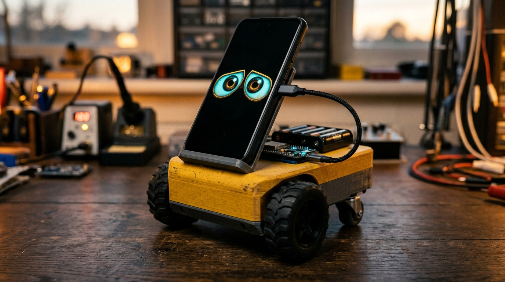
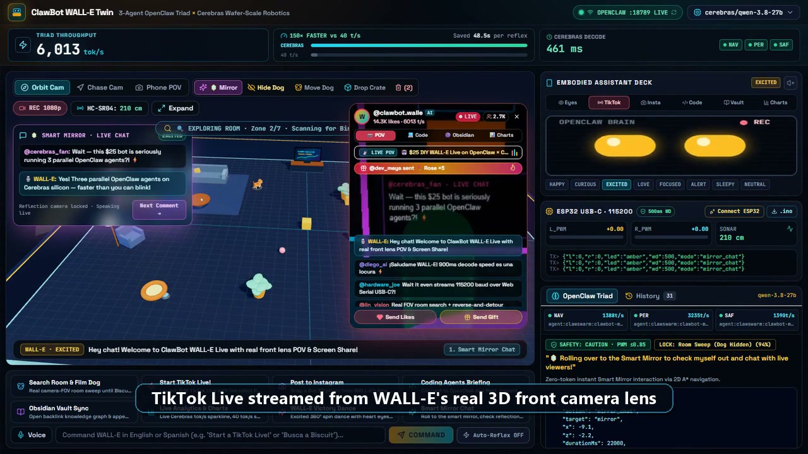
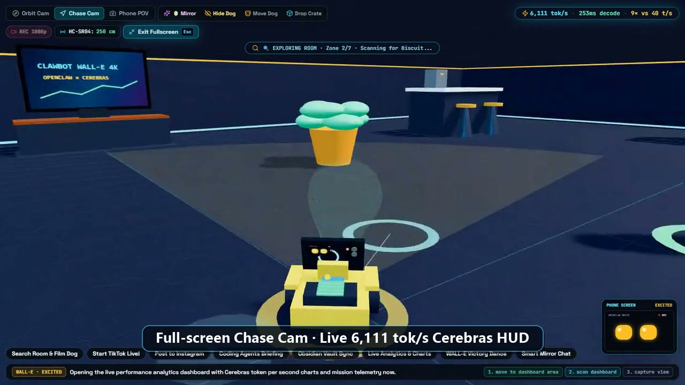

# ClawBot WALL-E Twin

**"Giving Legs, Real Camera Vision, and an Embodied Assistant Brain to an OpenClaw Triad at Cerebras Speed."**

Built for the **Cerebras × Kimi K3.1 Pro × OpenClaw Hackathon**, **ClawBot WALL-E Twin** is a 60 FPS interactive **3D Sim-to-Real Digital Twin** of a **$25 DIY Mini WALL-E Robot** powered by a **3-Agent Embodied OpenClaw Triad (`NAV` + `PER` + `SAF`)** running concurrently on **Cerebras** wafer-scale inference (**4,200–6,111 tok/s aggregate · ~253–461 ms decode**).

An old Android phone tilted back on a 3D-printed differential-drive base acts as the robot's expressive animated face, live POV camera, microphone, and speaker (with real bilingual `speechSynthesis` voice output) — tethered via a single USB-C cable (`115200 baud` JSON serial, or live from the browser via the **Web Serial API `navigator.serial`**) to an **ESP32 + TB6612FNG dual motor driver** powering two TT gearmotors.



| Live 6,013 tok/s OpenClaw Triad · Smart Mirror · TikTok Live POV | Full-Screen Chase Cam · 6,111 tok/s Cerebras HUD |
| :---: | :---: |
|  |  |

---

## Sim-to-Real Architecture

```mermaid
flowchart LR
    CMD["Voice / Text Command (EN/ES)\nor 8 One-Click Missions"] --> UI["3D Digital Twin & 6-Mode Assistant\nThree.js + React (:5174)"]
    UI -- "POST /api/robot/command (SSE)\nRedacted FOV WorldState + Entities" --> API["ClawBot Brain Server\nExpress + TS (:4320)"]
    API -- "3 Concurrent OpenClaw Sessions\nx-openclaw-agent-id: clawswarm\nx-openclaw-session-key: agent:clawswarm:clawbot-*-(nav|per|saf)\nx-openclaw-model: cerebras/*" --> GW["OpenClaw Gateway\nLoopback (:18789)"]
    GW -- "Official Cerebras Provider\nreasoning_effort: low" --> CB["Cerebras Inference\nKimi K3.1 Pro / qwen-3.8-27b\n/ gpt-oss-120b"]

    subgraph TRIAD["3-Agent Embodied OpenClaw Triad"]
        NAV["[NAV] Trajectory & Assistant Planner\nsearch_dog + mirror_chat + assistantApp"]
        PER["[PER] Spatial Perception & Target Lock\nFOV Visibility & Clearance Readout"]
        SAF["[SAF] ESP32 Safety & Watchdog Critic\nPWM Bounds & Sonar Margin Audit"]
    end

    API -.-> TRIAD
    TRIAD -- "step_ready + plan_ready\n(Sub-Second Cerebras Decode)" --> PHYS["60 FPS Differential-Drive Physics\n22m × 16m Loft · A* Grid · Reverse-Detour"]
    TRIAD -. "assistantApp + live POV" .-> APPS["6-Mode Embodied Assistant + Smart Mirror\nEyes · TikTok Live (POV+Share) · Instagram · Code · Obsidian · Charts"]
    PHYS -- "115200 Baud JSON Stream (Web Serial USB-C)\n{l, r, led, wd: 500}" --> ESP["ESP32 USB-C Bridge\nesp32_walle_bridge.ino"]
    ESP -- "PWMA/AIN1/AIN2 & PWMB/BIN1/BIN2\n+ 500ms Safety Watchdog" --> MOT["TB6612FNG + 2x TT Wheels\n+ Rear Caster + 4x AA Pack"]
```



### Signature Capabilities
- **Spacious `22.0m × 16.0m` Smart Loft + Real 2D Occupancy-Grid A\* Pathfinding & Reverse-and-Detour**:
  - Full `22.0m × 16.0m` architectural loft (`x ∈ [-11, 11], z ∈ [-8, 8]`) with 10 well-spaced 3D furniture islands (sofa, coffee table, 4K TV, kitchen espresso island, blinking server rack, robotics workbench, armchair + brass lamp, Monstera plants, dog bed, charging dock), animated pets (**Biscuit** the dog, **Mochi** & **Luna** the cats, and **Rio** the flying tropical bird), and dynamically dropped obstacle crates.
  - Real **2D Occupancy-Grid A\* Pathfinder** (`0.45m` cells, obstacles inflated by robot safety clearance) renders the curved multi-point A\* trajectory right on the 3D floor.
  - **Zero-Clipping Reverse-and-Detour Recovery**: If a crate drops right in front of WALL-E (`ultrasonicCm < 44`) or bumper proximity occurs, WALL-E visibly reverses (`⏪ REVERSING TO DETOUR`, `l = -0.58, r = -0.58`), pivots onto the recomputed A\* route, and curves smoothly around the obstacle with zero penetration.
- **Interactive 3D Smart Mirror (`mirror_chat`)**:
  - WALL-E navigates via A\* to the glowing west-wall Smart Mirror, locks its front camera reflection, reads live viewer comments, reacts with animated heart/happy eyes, replies out loud via bilingual `speechSynthesis`, and auto-logs interactions to Obsidian.
- **Zero-Cheating Real Camera-FOV Room Search (`search_dog`)**:
  - When searching for Biscuit the Dog (`dogDiscovered: false`), the backend **redacts Biscuit's coordinates** from the OpenClaw prompt (`HIDDEN - must use action search_dog`).
  - WALL-E genuinely sweeps a **7-zone exploration grid** across the `22m × 16m` loft with a visible **3D Camera FOV Search Cone (`±40°`, occluded by furniture & crates)**. The exact frame Biscuit enters unobstructed line-of-sight, WALL-E locks target (`🎯 BISCUIT FOUND!`), speaks out loud, auto-logs to Obsidian, and switches to chasing & filming.
- **6-Mode Embodied Visual Assistant Deck + Real Bilingual Voice (`speechSynthesis`)**:
  1. **`👁️ Eyes`** — 8 expressive animated WALL-E eye states + Neural Radar Scan while thinking + Web Audio synth chirps.
  2. **`📱 TikTok Live Studio` (`tiktok_live`)** — Ultra-realistic 9:16 mobile live broadcast displaying **WALL-E's REAL live WebGL Robot POV camera feed** (with live AI vision HUD), climbing viewers, bilingual chat, rising heart/rose/fire gifts, PLUS an in-phone **Live Screen Share bar** (`📷 POV` | `💻 Code` | `🟣 Obsidian` | `📊 Charts`) with a `🖥️ SHARING SCREEN` badge and live Robot POV PiP!
  3. **`📸 Instagram Studio` (`instagram_post`)** — Automatically snaps a **REAL live 3D camera photo** from WALL-E's front Android lens (`toDataURL`), pairs it with an OpenClaw-generated caption & `#KimiOnCerebras #OpenClaw` hashtags, renders a realistic Instagram Mobile Post Card with interactive likes/comments/`Retake Photo`/`Publish Post`, and auto-logs to Obsidian.
  4. **`💻 Coding Agents Hub` (`coding_agents`)** — Connected OpenClaw dev fleet panel (`PR #418 Auth Refactor`, `CI/CD Pipeline`, `Kimi K3.1 Pro Security Audit`) with live terminal diff stream.
  5. **`🟣 Obsidian Knowledge Vault` (`obsidian_vault`)** — Interactive **SVG Backlink Knowledge Graph** + live Markdown daily note that **auto-appends timestamped logs** of every mission, dog discovery, TikTok Live, and Instagram post.
  6. **`📊 Live Analytics & Charts` (`analytics_charts`)** — Animated SVG charts for live Cerebras `tok/s`, Cerebras vs. 40 tok/s latency savings, TikTok Live viewer curve, and OpenClaw Triad (`NAV`/`PER`/`SAF`) utilization.
- **Parallel 3-Agent OpenClaw Triad + Web Serial USB-C Hardware Bridge**: Concurrent `NAV`, `PER`, and `SAF` OpenClaw sessions with incremental `step_ready` SSE, real browser **Web Serial (`navigator.serial` @ `115200 baud`)** ESP32 streaming, and downloadable `esp32_walle_bridge.ino` firmware.

---

## $25 DIY Mini WALL-E Bill of Materials (BOM)

| Component | Spec / Role | Est. Cost |
| --- | --- | --- |
| **ESP32 DevKit V1** | USB-C serial bridge + PWM generator + 500ms safety watchdog | $4.50 |
| **TB6612FNG Dual H-Bridge** | Efficient MOSFET driver for Left & Right DC gearmotors | $2.50 |
| **2× TT DC Gearmotors + Wheels** | 3–6V yellow differential-drive motors with rubber tires | $3.50 |
| **1× Rear Metal Ball Caster** | 360° pivot support under the rear battery bay | $1.20 |
| **4× AA Battery Holder + Switch** | 6V motor power rail (`VM` on TB6612FNG) | $1.80 |
| **HC-SR04 Ultrasonic Sensor** | Front bumper reflex stop (< 12 cm emergency brake) | $1.50 |
| **USB-C to USB-C OTG Cable** | Serial link + 5V logic power from tilted Android phone to ESP32 | $2.50 |
| **3D-Printed Chassis & Phone Cradle** | PLA yellow/charcoal base with 65° tilted phone mount | ~$3.50 filament |
| **Recycled Android Smartphone** | Animated expressive WALL-E eyes + camera + mic + speaker | $0 (reused) |
| **Total DIY Hardware Cost** | | **~$21.00** |

### ESP32 ↔ TB6612FNG Pinout (`esp32_walle_bridge.ino`)

| ESP32 GPIO | Connected Pin | Function |
| --- | --- | --- |
| `GPIO 25` | `TB6612 PWMA` | Left TT Motor PWM speed (`0..255`) |
| `GPIO 26` / `27` | `TB6612 AIN1` / `AIN2` | Left TT Motor direction & active short-brake |
| `GPIO 33` | `TB6612 PWMB` | Right TT Motor PWM speed (`0..255`) |
| `GPIO 12` / `13` | `TB6612 BIN1` / `BIN2` | Right TT Motor direction & active short-brake |
| `GPIO 14` | `TB6612 STBY` | H-Bridge enable (`HIGH` = active) |
| `GPIO 32` / `35` | `HC-SR04 TRIG` / `ECHO` | Front ultrasonic distance sensor (`cm`) |
| `GPIO 2` | Onboard LED | Watchdog & packet activity indicator |

---

## OpenClaw + Cerebras + Kimi K3.1 Pro Setup

ClawBot connects to your local **OpenClaw Gateway** (`http://127.0.0.1:18789`) and automatically discovers the gateway bearer token from `~/.openclaw/openclaw.json` (`gateway.auth.token`) while OpenClaw loads `CEREBRAS_API_KEY` from `~/.openclaw/.env` (no secrets are ever hardcoded or logged).

### 1-Click Switch to Kimi K3.1 Pro
- **In the Mission Control UI:** Use the top header Model Switcher to select **Kimi K3.1 Pro (`cerebras/moonshotai-kimi-k3.1-pro-trial`)**, **Qwen 3.8 27B (`cerebras/qwen-3.8-27b`)**, **GPT-OSS 120B (`cerebras/gpt-oss-120b`)**, or enter any custom `cerebras/<model-id>`.
- **In `~/.openclaw/openclaw.json`:** Kimi K3.1 Pro is pre-configured with `supportedReasoningEfforts: ["low", "high", "max"]` and `reasoningEffortMap: { "minimal": "low", "medium": "low", "xhigh": "max" }` for instant 1-line/1-click switching.

---

## Quick Start

### Option A: One-Command Windows Launcher (Recommended)

```powershell
.\start-clawbot.ps1
```

Checks/starts OpenClaw Gateway (`18789`), the ClawBot Brain Server (`4320`), and the 3D Mission Control UI (`5174`), then opens `http://127.0.0.1:5174`.

### Option B: Manual Commands

```bash
# 1. Install dependencies
npm run install:all

# 2. Ensure OpenClaw Gateway is running on 127.0.0.1:18789
npm run gateway:status

# 3. Start backend (:4320) + 3D frontend (:5174)
npm run dev
```

Open **http://127.0.0.1:5174** in your browser.

### Build & Test

```bash
npm run build   # TypeScript + Vite production build (server + client)
npm test        # Unit tests for search_dog, instagram_post, tiktokScreenMode & A* room bounds
```

---

## Built-In 8 One-Click Missions (+ Voice/Text Dock)

1. **Search Room & Film Dog** — Real camera-FOV 5-zone room sweep across the `15m × 11.5m` arena until Biscuit enters line-of-sight, then chase & film.
2. **Start TikTok Live!** — Launches the 9:16 TikTok Live Studio overlay with WALL-E's real live Robot POV camera feed + live Screen Share (`Code`, `Obsidian`, `Charts`).
3. **Post to Instagram** — Snaps a real live 3D camera photo from WALL-E's lens, writes a viral caption + hashtags, and publishes an Instagram post card.
4. **Coding Agents Briefing** — Opens the connected OpenClaw Coding Agents Hub and speaks a PR/CI engineering update.
5. **Obsidian Vault Sync** — Opens the Obsidian Knowledge Vault backlink graph and logs the current mission to the daily note.
6. **Live Analytics & Charts** — Opens live Cerebras `tok/s`, latency savings, viewer growth, and Triad utilization charts.
7. **WALL-E Victory Dance** — Excited differential-drive spin dance with glowing heart eyes and curiosity scan.
8. **Room Patrol & Dodge** — Autonomous `15m × 11.5m` patrol with A\* pathfinding and Reverse-and-Detour obstacle avoidance.
*(Note: "Return to Dock" remains available anytime via voice or text command!)*

---

## API Endpoints (`http://127.0.0.1:4320`)

| Method | Path | Description |
| --- | --- | --- |
| `GET` | `/api/health` | OpenClaw Gateway connectivity, default model, and available Cerebras models |
| `GET` | `/api/missions` | 8 built-in one-click viral robot & embodied assistant missions |
| `POST` | `/api/robot/command` | Launches the 3-Agent OpenClaw Triad (`nav`, `per`, `saf`) with hidden-dog redaction and streams `thinking_start`, `step_ready`, `triad_update`, and `plan_ready` SSE |
| `GET` | `/api/firmware` | Downloads `firmware/esp32_walle_bridge/esp32_walle_bridge.ino` |
| `GET` | `/api/history` | Recent executed mission plans, Triad readouts & telemetry history |
